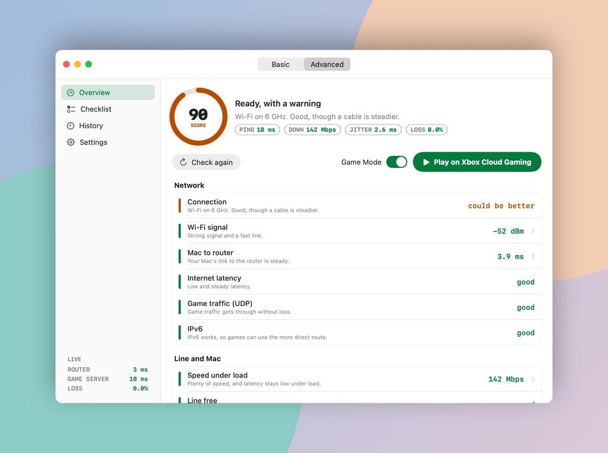

<div align="center">


# 🎮 Game Ready

**Free Mac app for cloud gamers: checks your Mac, Wi-Fi and internet, switches on Game Mode, and tells you which one causes the lag**


[](https://github.com/CaputoDavide93/MacOS-Game-Mode/releases/latest)
[](https://github.com/CaputoDavide93/MacOS-Game-Mode/actions/workflows/ci.yml)

</div>

---

## 💡 Why Game Ready

Cloud gaming (Xbox Cloud Gaming, GeForce NOW, Amazon Luna) lags for very different reasons: the
Mac's own Wi-Fi pausing for AirDrop, the household line filling up, or the game's servers. On
screen they all look the same, and a speed test says nothing about which one it is.

Game Ready measures each layer separately, gives one plain verdict, and switches off what you
can switch off on the Mac. While you play, it labels every hiccup as the Mac's Wi-Fi, the
internet, or the Mac.

| | Game Ready | A web speed test | Doing it by hand |
|---|---|---|---|
| Checks the Mac-to-router hop apart from the internet | Yes | No: a web page cannot ping your router | Yes, with Terminal `ping`, one target at a time |
| Latency to the game server, UDP loss, speed under load | In one check | Speed and latency only | Separate tools |
| Switches off AirDrop's radio, Handoff, Low Power Mode and update downloads, then puts them back | One click, one password prompt | No | Many settings across System Settings and Terminal, and you remember to undo each |
| Labels lag while you play | Yes: Mac's Wi-Fi, internet or Mac | No | No |
| Account or cloud service | None | Usually none | None |

The trade-off: Game Mode needs your administrator password, and the app is not notarised yet,
so the first launch needs **Open Anyway**.

### Install in 3 steps

You need an Apple silicon Mac on macOS 15 or later.

1. Get **Game-Ready.zip** from the [latest release](https://github.com/CaputoDavide93/MacOS-Game-Mode/releases/latest) and unzip it.
2. Move **Game Ready** to Applications and open it. The first time, open **System Settings → Privacy & Security** and choose **Open Anyway**.
3. Choose **Check now**, then **Fix & Play**.

Every screen is walked through in [docs/setup.md](docs/setup.md).

---

## 📸 Screenshots

<table>
  <tr>
    <td align="center" width="50%"><picture><source media="(prefers-color-scheme: dark)" srcset="docs/assets/screenshots/basic-dark.png"></picture><br><sub>Basic: what Fix &amp; Play will do</sub></td>
    <td align="center" width="50%"><picture><source media="(prefers-color-scheme: dark)" srcset="docs/assets/screenshots/basic-ready-dark.png"></picture><br><sub>Basic: ready to play</sub></td>
  </tr>
  <tr>
    <td align="center" width="50%"><picture><source media="(prefers-color-scheme: dark)" srcset="docs/assets/screenshots/advanced-overview-dark.png"></picture><br><sub>Advanced: overview</sub></td>
    <td align="center" width="50%"><picture><source media="(prefers-color-scheme: dark)" srcset="docs/assets/screenshots/advanced-checklist-dark.png"></picture><br><sub>Advanced: checklist</sub></td>
  </tr>
  <tr>
    <td align="center" width="50%"><picture><source media="(prefers-color-scheme: dark)" srcset="docs/assets/screenshots/advanced-history-dark.png"></picture><br><sub>Advanced: history</sub></td>
    <td align="center" width="50%"><picture><source media="(prefers-color-scheme: dark)" srcset="docs/assets/screenshots/advanced-settings-dark.png"></picture><br><sub>Advanced: settings</sub></td>
  </tr>
  <tr>
    <td align="center" colspan="2"><picture><source media="(prefers-color-scheme: dark)" srcset="docs/assets/screenshots/menubar-dark.png"></picture><br><sub>Menu bar, during a game</sub></td>
  </tr>
</table>

All screenshots use demo data (`--screenshots`), never a real network.

---

## ✨ Features

| | Feature | What it does |
|---|---|---|
| 🎚️ | Basic and Advanced | **Basic**: one status and one button, Fix & Play, which applies every fix and opens the game. **Advanced**: every number, a readiness score, grouped results |
| 🩺 | Pre-flight check | About a minute, covering connection type, Wi-Fi signal, the Mac → router hop, internet and game-server latency, UDP loss over IPv4 and IPv6, speed with latency under load, whether the line is busy, the Mac's power and heat, background apps, and a checklist |
| 🚦 | One verdict | Ready, Ready with a warning, Not ready, or Couldn't finish. A check that couldn't measure never counts as a pass |
| ⚡ | Game Mode | Switches off the AirDrop/Handoff radio (and keeps it off, so AirDrop can't interrupt), turns off Handoff, Universal Control, the AirPlay Receiver and Low Power Mode, pauses Time Machine, stops new automatic macOS and App Store update downloads from starting, keeps the Mac awake, quits apps that get in the way. One password prompt covers all of it; every setting is put back on "off" or quit, even after the app crashes. If the Mac restarts mid-session, turning off asks for the password once more to put back the settings that needed it |
| 🎮 | Play | Opens Xbox Cloud Gaming, GeForce NOW (its Mac app when installed) or Amazon Luna |
| 🎛️ | Better xCloud | Reads its settings to tick the checklist; opt-in, Game Mode sets the highest bitrate, the high H.264 profile and Prefer IPv6, and puts your own values back on "off" |
| 📈 | Live watch | While Game Mode is on, a menu-bar dot and a log label every hiccup: the Mac's Wi-Fi, the internet, or the Mac |
| 📵 | AirDrop off | Optional, in Settings: never, while Game Mode is on, or always. macOS only lets AirDrop be switched off by a configuration profile you approve in System Settings → General → Device Management; Game Ready opens it for you, and removes it itself (after your password, or automatically when Game Mode goes off) |
| ☑️ | Checklist | The settings no app can change for you (Location Services, AirDrop, Handoff, browser energy saver, stream quality), detected where macOS allows |
| 🗂️ | History | Checks and game sessions for 90 days on the Mac, CSV export, Delete All Data |
| 🔒 | Private | No accounts, analytics or update checks. Only test traffic leaves the Mac |
| 🌍 | Languages | English, Italian, Spanish, French, German, Portuguese (Brazil), Japanese, Chinese (Simplified), Korean and Hindi. Follows the Mac's language |

---

## 🗺️ Architecture

<picture>
  <source media="(prefers-color-scheme: dark)" srcset="docs/assets/architecture-dark.svg">
  
</picture>

- **`Packages/GameReadyCore`**: every rule, in pure Swift with no I/O: grading, the verdict,
  speed-test validation, the live-watch classifier, history, and the Game Mode guard script.
- **`App/`**: the probes (ping, UDP, speed, Wi-Fi, power, apps), Game Mode, the live watch
  and the SwiftUI screens.

How the pieces work: [docs/how-it-works.md](docs/how-it-works.md). Why each choice was made: [docs/decisions.md](docs/decisions.md). Look and feel: [docs/design.md](docs/design.md).
All guides: [docs/README.md](docs/README.md), including the [FAQ](docs/faq.md) and [troubleshooting](docs/troubleshooting.md).

---

## 🚀 Quick Start

The download steps are under [Install in 3 steps](#install-in-3-steps).

### Build from source

Requires an Apple silicon Mac with macOS 15 or later, Xcode 16+, and [XcodeGen](https://github.com/yonaskolb/XcodeGen).

```bash
brew install xcodegen
scripts/build.sh                      # → build/…/Game Ready.app and dist/Game-Ready.zip
open "build/dd/Build/Products/Release/Game Ready.app"
```

The build is ad-hoc signed, not notarised, so the first launch needs **Open Anyway** as above.

To release: bump `MARKETING_VERSION` in `project.yml`, move the CHANGELOG's `[Unreleased]`
notes under the new version, then `git tag vX.Y.Z && git push --tags`. The Release workflow
tests, builds and publishes the zip with those notes.

---

## ✅ Supported and tested

| | Status |
|---|---|
| Apple silicon, macOS 27 (M-series, wired) | Tested: full check, verdict and screenshots |
| macOS 15 to 26 | Supported by the deployment target, not tested by the author |
| Intel Macs | Not supported (arm64 build only) |
| Wi-Fi | Not yet tested end to end; the logic is covered by unit tests |
| Xbox Cloud Gaming, GeForce NOW, Amazon Luna | The Play button opens each; not yet run against each service |
| Chrome, Safari, Edge | Better xCloud reading not yet run against the real page in any of them |

The full list of what is verified and what is not: [docs/testing.md](docs/testing.md).

---

## 📖 Usage

1. **Check now** (⌘R). Each step shows as it runs; the verdict card says what matters most.
2. Switch on **Game Mode** (⌘G). macOS asks for your password once.
3. **Play** (⌘P) opens your gaming service (Settings: Xbox Cloud Gaming, GeForce NOW or Amazon Luna) in Chrome, Safari or Edge.
4. Watch the dot in the menu bar. Turning Game Mode off puts every setting back and saves the session to History.

<details>
<summary>Letting Game Ready read and tune Better xCloud</summary>

1. Install [Better xCloud](https://github.com/redphx/better-xcloud) and open xbox.com once.
   Game Ready uses your Mac's default browser until you pick one in Settings; the switch below
   is per browser (and, in Chrome, per profile), so it has to be the one you play in.
2. In that browser, allow scripts from other apps: **Chrome / Edge:** View → Developer → Allow
   JavaScript from Apple Events. **Safari:** Settings → Advanced → Show features for web
   developers, then Settings → Developer → Allow JavaScript from Apple Events.
3. Come back to Game Ready: it checks again by itself (or press **Refresh** on the Better xCloud
   card in Checklist). macOS asks once whether Game Ready may control the browser. If another
   supported browser is the one open, the card offers to switch to it.
4. To have Game Mode tune it, turn on **Game Mode also tunes Better xCloud** in Settings.

The browser option lets any app you have allowed to control it run scripts in your web pages,
which is why it's off by default. Game Ready only ever runs the two fixed scripts in
`BetterXcloud.swift`.

</details>

From Terminal:

```bash
APP="build/dd/Build/Products/Release/Game Ready.app/Contents/MacOS/Game Ready"
"$APP" --check              # one check, results as JSON; exit 0 only when Ready
"$APP" --check --no-speed   # the same, without loading the line
"$APP" --screenshots out/   # every screen with demo data, light and dark
```

<details>
<summary>What each check measures</summary>

| Check | How | Good |
|---|---|---|
| Connection | Primary interface | Ethernet (6/5 GHz Wi-Fi warns, 2.4 GHz fails) |
| Wi-Fi signal (on a cable: Ethernet link) | CoreWLAN signal and link rate; on Ethernet the port's negotiated speed and duplex | ≥ −60 dBm, ≥ 600 Mbps; on Ethernet ≥ 1000 Mbps, full duplex |
| Mac to router | 100 pings at 10/s | worst < 10 ms, no loss |
| Internet latency | 50 pings to 1.1.1.1, and to the game server for Xbox Cloud Gaming | < 25 ms, jitter < 5 ms, no loss |
| Game traffic (UDP) | 200 DNS queries over IPv4 and IPv6 | no loss, p95 < 30 ms |
| IPv6 | Global address and UDP over IPv6 | works; no IPv6 is never a failure, but IPv6 that loses packets fails the UDP check |
| Speed under load | 10 s download + 10 s upload, 4 streams, pinging all along | ≥ 40 Mbps down, latency rise < 15 ms |
| Line free | Idle latency vs. the best of the last 14 days (the first check has nothing to compare with and says so) | within 10 ms |
| This Mac | AirDrop radio, Low Power Mode, battery, heat, CPU | off, off, on power, nominal, < 80% |
| Background apps | Running apps from the Settings list, Time Machine | none |
| Checklist | Ticked or detected settings | all done |

Thresholds live in `Thresholds.swift`.

</details>

---

## 📁 Repo structure

```text
MacOS-Game-Mode/
├── App/
│   ├── Sources/            # 📱 probes, Game Mode, models, SwiftUI screens
│   ├── Resources/          # 🌍 Localizable.xcstrings (generated), icon sizes (generated)
│   ├── Design/             # 🎨 AppIcon.svg, the icon's source
│   └── Info.plist, GameReady.entitlements
├── Packages/GameReadyCore/ # 🧠 rules + tests, no I/O
├── docs/                   # 📚 setup, how it works, FAQ, troubleshooting, decisions, privacy, testing, assets
├── scripts/                # 🛠️ build.sh, check.sh
├── tools/                  # 🔧 strings/<lang>.json + gen_strings.py, gen_diagram.py, gen-icon.sh, strip_png.py, social-preview.*
├── .github/workflows/      # 🤖 ci.yml, release.yml
├── Makefile                # 🧰 check, screenshots, social-preview
├── project.yml             # ⚙️ XcodeGen project (the .xcodeproj is generated)
├── .env.example            # 🔑 optional SIGN_ID for a signed build
├── .gitignore
├── AGENTS.md               # 🤖 rules for coding agents
├── CLAUDE.md               # 🤖 imports AGENTS.md for Claude Code
├── CHANGELOG.md
├── llms.txt                # 🤖 the project in one page for AI search
├── SECURITY.md
├── LICENSE
└── README.md
```

---

## 🧪 Testing

```bash
make check                  # core tests, strings, diagram, shell lint, Release build (same as scripts/check.sh)
make screenshots            # retake docs/assets/screenshots/ from the demo data
```

What's covered automatically and what has been verified on a real Mac: [docs/testing.md](docs/testing.md).

---

## 🔒 Security

Game Mode runs one script as root, after the macOS password prompt. The script is compiled
into the app, accepts only the app's own flag file, records what it changes and puts it back.
Details and how to report a problem: [SECURITY.md](SECURITY.md). Every privacy promise and its limits: [docs/privacy.md](docs/privacy.md).

---

## 🤝 Contributing

Most of what Game Ready does has not yet been run on every Mac, Wi-Fi setup and service. Reports
from other setups are the most useful contribution. Open an issue with:

- your Mac model, macOS version, and wired or Wi-Fi (no network name or address needed);
- the output of `Game Ready --check --no-speed` run from Terminal as shown in [Usage](#-usage) (JSON with grades and numbers, no network name);
- what you expected and what happened, plus a screenshot if text is clipped.

Before a pull request, run `make check`. Strings are edited in `tools/strings/*.json`, never in
the generated catalogue; see [AGENTS.md](AGENTS.md).

---

## 📄 License

[MIT](LICENSE)

---

<p align="center"><sub>Made with ❤️ by <a href="https://github.com/CaputoDavide93">Davide Caputo</a></sub></p>
