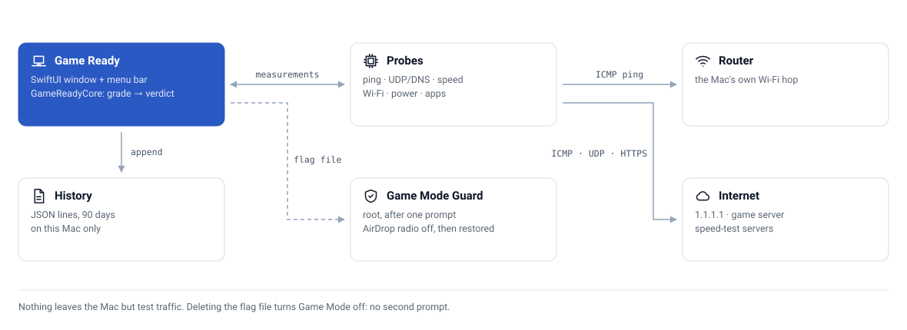

# How it works

Game Ready measures the layers between your Mac and the game separately, so a slow result points at one of them.

<picture>
  <source media="(prefers-color-scheme: dark)" srcset="assets/architecture-dark.svg">
  
</picture>

## The probes

Every probe runs on your Mac. Ping uses `/sbin/ping`; UDP uses Network.framework; the speed test uses plain HTTPS. The table of checks, with what counts as good, is in the [README](../README.md#-usage). Thresholds live in `Thresholds.swift`.

A check that cannot measure never counts as a pass: silence from a target is "couldn't measure", and a speed test counts only if the bytes arrived ([D4, D6, D14](decisions.md)).

## The layer split

Two pings run side by side: one to the router (the Mac's own Wi-Fi hop) and one to the game service. A bad router reading blames the Mac's Wi-Fi. A fine router and a bad server reading blames the internet. A bad server reading with no router reading blames nobody. This is how Game Ready tells AirDrop's radio pausing the Wi-Fi from a busy household line ([D5](decisions.md)). The live watch labels hiccups during a game with the same split, and adds the Mac itself as a third label.

## The verdict

Results are codes; the words live in the UI ([D3](decisions.md)). The verdict is one of Ready, Ready with a warning, Not ready, or Couldn't finish. The readiness score in Advanced is a weighted pass rate ([D20](decisions.md)).

## Game Mode

Game Mode changes five settings as root (the AirDrop/Handoff radio, Low Power Mode, Time Machine automatic backups, automatic macOS update downloads and automatic App Store update downloads) and three as you (Handoff, Universal Control, the AirPlay Receiver). It saves the originals first, and puts back only what it changed.

- The root part is one script compiled into the app. It asks for your password once, checks a flag file every few seconds, and restores everything when the flag disappears, the script stops, or after 12 hours.
- Turning Game Mode off deletes the flag file. No second password prompt is needed, except after a restart mid-session, when the saved originals are restored.
- If the current value of a setting cannot be read, or the undo plan cannot be saved, nothing is changed.

The full list of what the script may do is in [SECURITY.md](../SECURITY.md); the reasoning is in [D13, D15, D18, D21 and D22](decisions.md).

## History and privacy

Check results and session summaries are JSON lines in `~/Library/Application Support/Game Ready/history.jsonl`, pruned after 90 days. The only network traffic is test traffic to the hosts listed in `Endpoints.swift`, and a test fails on any other host. See [privacy.md](privacy.md).
