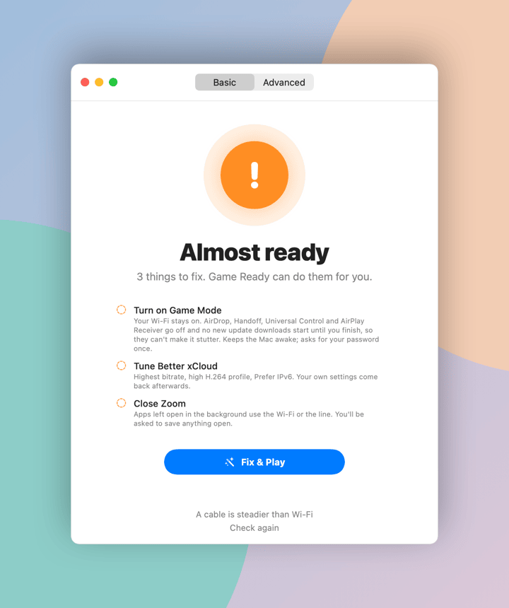
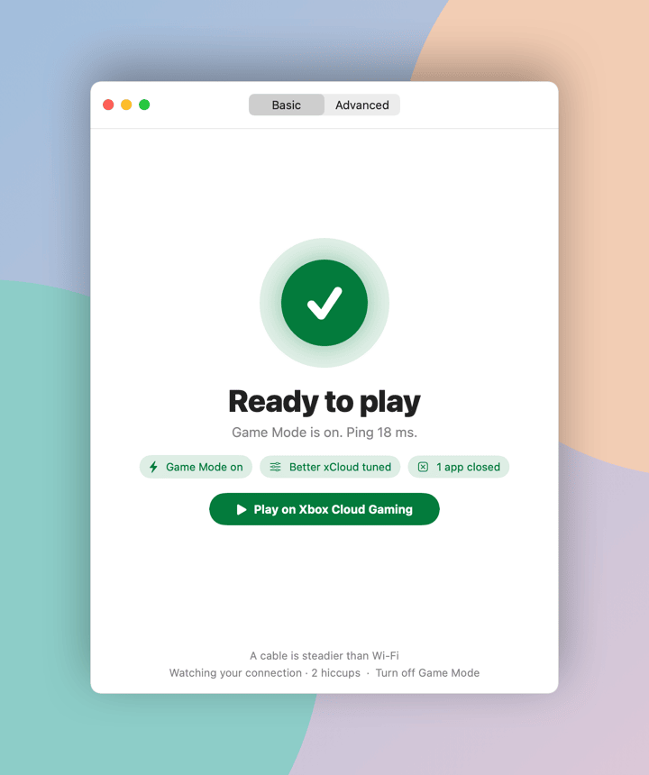
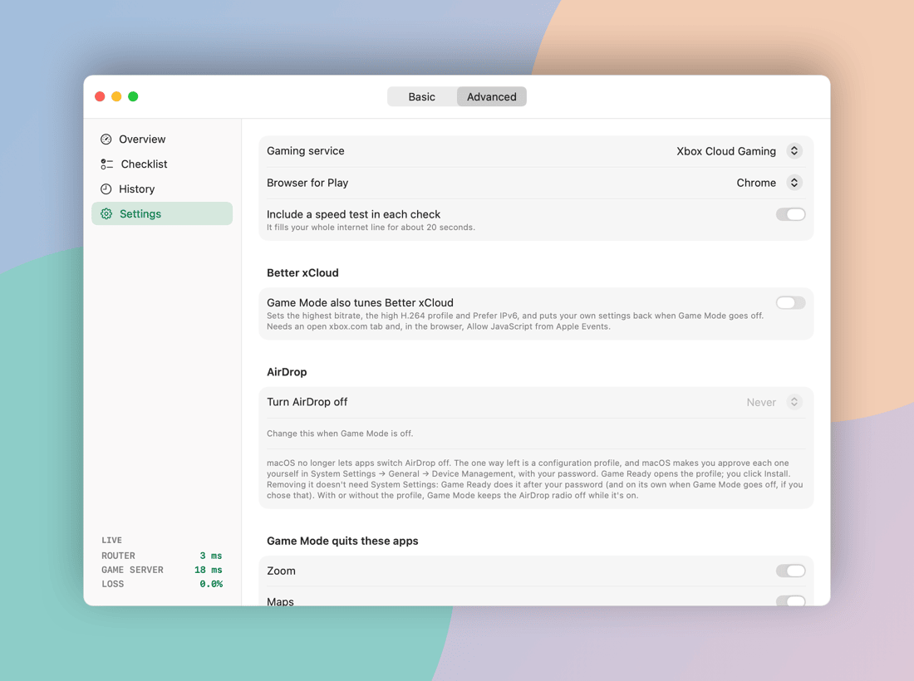
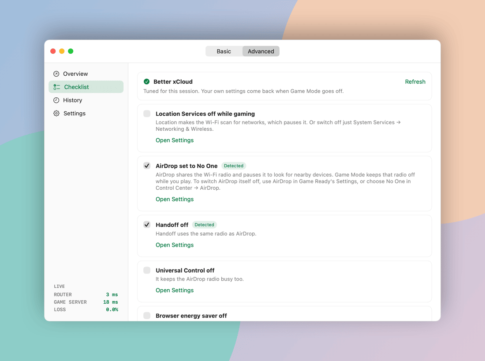
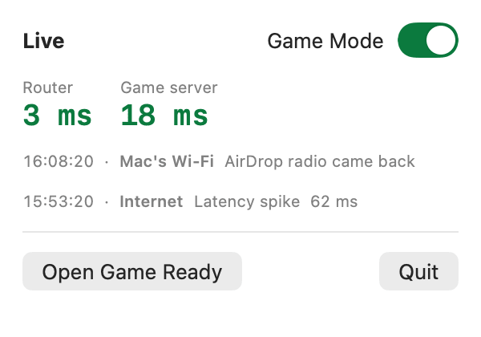
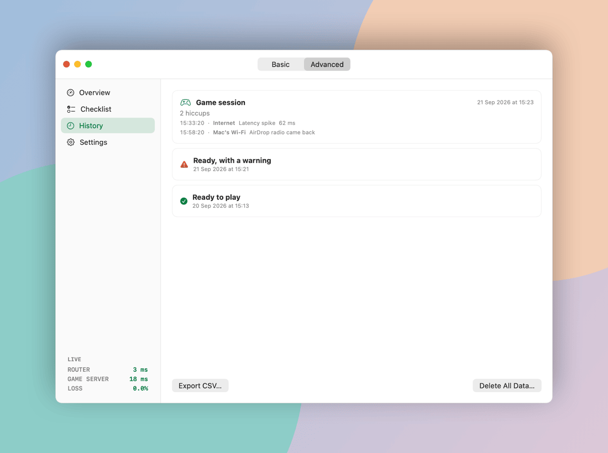

# Setup

You need an Apple silicon Mac on macOS 15 or later. Game Ready is free and needs no account.
Screenshots show demo data, not a real network.

## 1. Download and open

1. Get **Game-Ready.zip** from the [latest release](https://github.com/CaputoDavide93/MacOS-Game-Mode/releases/latest) and unzip it.
2. Move **Game Ready** to Applications and open it.
3. macOS blocks the first launch because the app is not notarised yet. Open **System Settings → Privacy & Security** and choose **Open Anyway**.

Prefer to build it yourself? See [Build from source](../README.md#build-from-source).

## 2. Run the first check

The Basic window opens. Choose **Check now** (⌘R). Each step shows as it runs. When it finishes, the card says what matters most, and lists the fixes Game Ready can make for you.

<picture><source media="(prefers-color-scheme: dark)" srcset="assets/screenshots/basic-dark.png"></picture>

## 3. Fix and play

**Fix & Play** turns on Game Mode, tunes Better xCloud when you have allowed it, closes the apps you chose in Settings, then opens your game. macOS asks for your password once. If you cancel the prompt, nothing is launched.

<picture><source media="(prefers-color-scheme: dark)" srcset="assets/screenshots/basic-ready-dark.png"></picture>

## 4. Pick your service and browser

Open **Advanced → Settings** to choose Xbox Cloud Gaming, GeForce NOW or Amazon Luna, your browser (Chrome, Safari or Edge), and the apps Game Mode may quit. GeForce NOW opens its Mac app when it is installed.

<picture><source media="(prefers-color-scheme: dark)" srcset="assets/screenshots/advanced-settings-dark.png"></picture>

## 5. Work through the checklist

**Advanced → Checklist** lists the settings no app can change for you, such as Location Services, browser energy saver and stream quality. Game Ready detects what macOS lets it detect.

<picture><source media="(prefers-color-scheme: dark)" srcset="assets/screenshots/advanced-checklist-dark.png"></picture>

## 6. Optional: let Game Ready tune Better xCloud

Only for Xbox Cloud Gaming with the [Better xCloud](https://github.com/redphx/better-xcloud) userscript. The steps are in the [README](../README.md#-usage). The browser option it needs lets any app you have allowed to control the browser run scripts in your pages, so it is off by default.

## 7. Optional: switch AirDrop off with a profile

In **Advanced → Settings**, choose when AirDrop should be off: never, while Game Mode is on, or always. macOS only allows AirDrop to be switched off by a configuration profile that you approve. Game Ready opens the profile, you approve it in **System Settings → General → Device Management**, and Game Ready removes it for you (after your password, or when Game Mode goes off).

## 8. Watch a session and review it

While Game Mode is on, a dot in the menu bar and a log label every hiccup as the Mac's Wi-Fi, the internet, or the Mac. Turning Game Mode off puts every setting back and saves the session to History.

<picture><source media="(prefers-color-scheme: dark)" srcset="assets/screenshots/menubar-dark.png"></picture>

<picture><source media="(prefers-color-scheme: dark)" srcset="assets/screenshots/advanced-history-dark.png"></picture>

History is kept on the Mac for 90 days. **Delete All Data** removes it.
